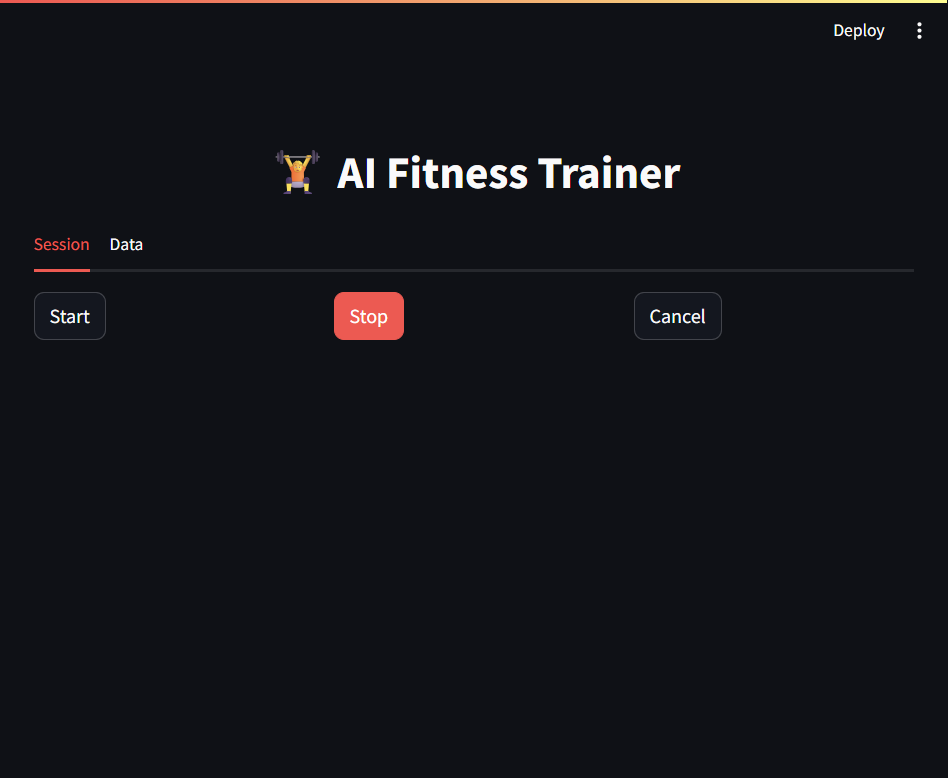
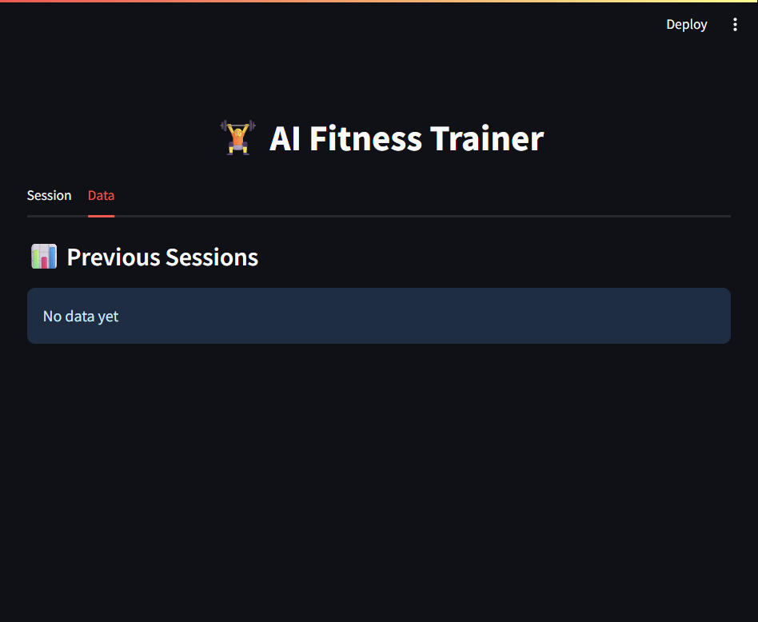

# Gym Analyse

A machine learning project for analyzing gym exercises, including pose detection, exercise classification, rep counting, and workout analytics.

## Features

- **Pose Detection**: Real-time pose estimation using computer vision
- **Exercise Classification**: ML model to classify different exercises
- **Rep Counter**: Automatic counting of repetitions
- **Form Analyzer**: Analyze exercise form for correctness
- **Session Manager**: Track workout sessions and history
- **Analytics**: Visualize workout data and progress

## Architecture


Webcam frames are captured with OpenCV, processed into pose landmarks and exercise features, then classified by the trained model. The resulting predictions feed rep counting and form analysis; Streamlit presents live feedback and session data is stored for analytics.

## UI Preview

### Workout Session



### Session Analytics



## Installation

1. Clone the repository
2. Create a virtual environment: `python -m venv minorenv`
3. Activate the environment: `minorenv\Scripts\activate` (Windows)
4. Install dependencies: `pip install -r requirements.txt`

## Usage

Run the main application:
```
streamlit run app.py
```

## Files

- `app.py`: Main Streamlit application
- `classifier.py`: Exercise classification model
- `rep_counter.py`: Repetition counting logic
- `form_analyzer.py`: Exercise form analysis
- `analytics.py`: Data analytics and visualization
- `train_model.py`: Model training script
- Other utility files for pose detection, feature extraction, etc.

Datasets, workout records, and locally trained model artifacts are excluded from Git.
Train or provide a model locally before running model-dependent features.

## Requirements

See `requirements.txt` for Python dependencies.

## License

This academic project is available under the MIT License. See [LICENSE](LICENSE) for details.

## Contact

For usage questions or extension ideas, contact [@HarshavardhanKakarla](https://github.com/HarshavardhanKakarla) or open an issue in this repository.